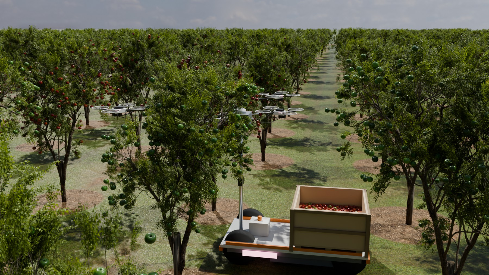
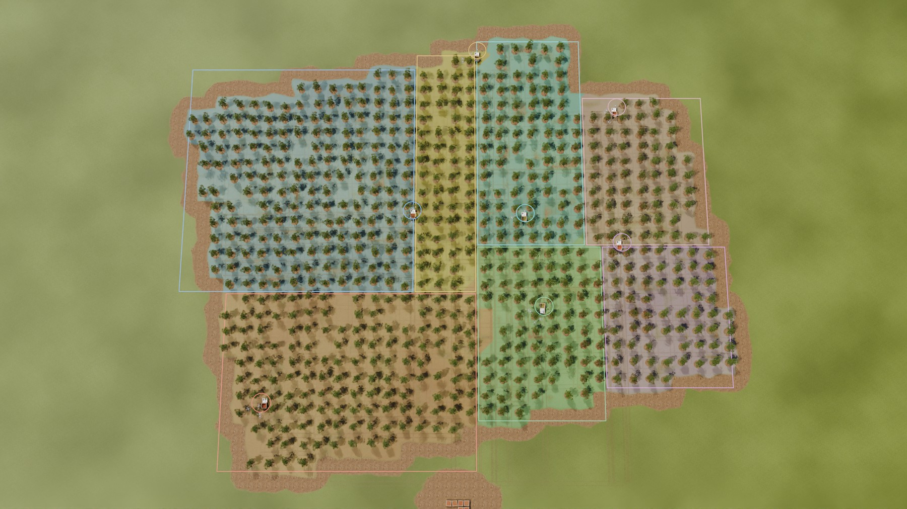
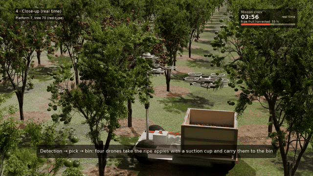
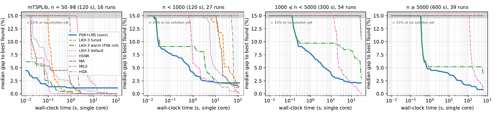

# Path–Split–Balance

### Who picks which apple—and where should the fleet go next?



Apple trees do not ripen on a convenient schedule. A robot returns with a full bin, the fruit visible from its new position changes, and suddenly yesterday’s route is no longer the right one.

**Path–Split–Balance (PSB)** is the route planner I built for this problem. It gives a harvesting fleet a complete plan quickly, then keeps improving that plan while the machines are working. The repository contains the planner, the orchard simulations, and the experiments behind our Precision Agriculture manuscript.

**[Watch the 95-second film](https://github.com/ufukasia/psb-precision-agriculture/releases/download/v1.0.0/ESM_1.mp4)** · **[Try a small example](#try-it-yourself)** · **[See the results](#what-we-found)** · **[Get the experiment data](https://github.com/ufukasia/psb-precision-agriculture/releases/download/v1.0.1/psb-reproducibility-data-v1.0.0.zip)**

*The orchard and machines on this page are Blender renderings of our simulations, not footage from a physical harvesting trial.*

## The practical problem

Changing a bin takes a short but finite amount of time. That is the window available for thinking about the next route. If planning takes longer, the platform waits.

PSB is designed around that window. In the reported experiments it returned an initial fleet plan in under a second. Given more time, it continued improving instead of forcing a choice between “fast” and “good.”

## What PSB actually does

The name is the method, without the jargon:

1. **Path.** Build one large tour through the trees.
2. **Split.** Cut that tour into one route per platform, choosing the cuts that minimize the longest route.
3. **Balance.** Move work between routes when one platform has drawn the short straw.
4. **Improve.** Keep searching for as much—or as little—time as is available.

For the harvesting simulations, PSB-MT/R adds bin-capacity trips, estimated service times, and replanning when a platform returns to the station.



*Colours show the six planning regions. They are not separate fields; work can be reassigned as the mission unfolds.*

## See it in motion

[](https://github.com/ufukasia/psb-precision-agriculture/releases/download/v1.0.0/ESM_1.mp4)

The short preview loops here. **[The full film](https://github.com/ufukasia/psb-precision-agriculture/releases/download/v1.0.0/ESM_1.mp4)** shows the whole mission, including close-up picking, bin changes, and a platform taking over unfinished work.

## What we found



The short time budgets are where PSB is most useful. It produces usable routes early and improves them steadily. It is not presented as the universal winner: on medium-sized instances with several minutes available, MILS produced better routes. That trade-off matters more to us than a cherry-picked leaderboard.

The experiments cover **136 routing instances**, comparisons with **LKH-3 and four published min–max methods**, and orchard simulations with uncertain fruit counts, ripeness, detection, bin capacity, and repeated harvesting passes.

## Try it yourself

Python 3.12 was used for the paper. A small PSB run needs only the Python packages in `requirements.txt`, not the external comparison solvers.

```bash
python -m venv .venv
. .venv/bin/activate
python -m pip install -r requirements.txt
python - <<'PY'
import sys
sys.path[:0] = ['.', 'experiments']
import instances
from mtsp import mm

orchard = instances.orchard(10, 12, shape='rect', seed=1)
routes, info = mm.solve(
    orchard['X'], orchard['Y'], orchard['dx'], orchard['dy'],
    k=4, workers=1,
)
print('Trees:', len(orchard['X']))
print('Initial makespan:', info['mk'])
print('Route sizes:', [len(route) for route in routes])
PY
```

The first call may spend a few seconds compiling Numba kernels. Later calls are faster.

## Where to look in the code

- **[`mtsp/mm.py`](mtsp/mm.py)** — the main PSB planner and its anytime improvement search.
- **[`mtsp/mtr.py`](mtsp/mtr.py)** — the capacity-aware harvesting extension.
- **[`sim/grid_sim.py`](sim/grid_sim.py)** — the event-based orchard mission.
- **[`experiments/`](experiments/)** — benchmark drivers and the scripts that generate the paper’s numbers.
- **[`blender/`](blender/)** — the scene and video-generation code.

The main branch is deliberately small: no virtual environments, solver binaries, manuscript build files, or render caches. Required benchmark data stay in `data/`.

<details>
<summary><strong>Reproduce every table without rerunning the experiments</strong></summary>

Download and extract the [results archive](https://github.com/ufukasia/psb-precision-agriculture/releases/download/v1.0.1/psb-reproducibility-data-v1.0.0.zip) in the repository root. It creates `experiments/out/` with all 4,403 run-level records and reports. Then run:

```bash
python experiments/report.py
python experiments/make_numbers.py
python experiments/make_numbers.py --prag-tr-quality
```

The generated tables and LaTeX macros appear in `generated/`.

</details>

<details>
<summary><strong>External solvers and licenses</strong></summary>

Third-party programs with unclear redistribution terms are not bundled. Their source URLs, revisions, and build notes are recorded in [`third_party/sota/SOURCES.txt`](third_party/sota/SOURCES.txt).

- **LKH-3 3.0.13:** install from Keld Helsgaun’s official distribution and set `LKH3_BIN`.
- **HSNR, MA, MILS, and HGA:** obtain them from the authors’ repositories. `HSNR_BIN`, `MA_BIN`, `MILS_BIN`, and `HGA_JULIA_DIR` override the default paths.
- **OR-Tools:** installed through `requirements.txt`.

Original code is **MIT licensed**. The film is **CC BY 4.0**. Third-party datasets, solvers, and visual assets retain their own licenses. Orchard boundaries come from **OpenStreetMap contributors** and remain under **ODbL 1.0**. Asset credits are in [`blender/realistic/assets/SOURCES.md`](blender/realistic/assets/SOURCES.md).

</details>

---

This is research code from a single-author study, not a finished farm product. If something is unclear or does not run on your machine, please open an issue and tell me what happened.

**Ufuk Asil** · OSTİM Technical University, Ankara · [ORCID](https://orcid.org/0000-0001-6769-2097) · ufuk.asil@ostimteknik.edu.tr
